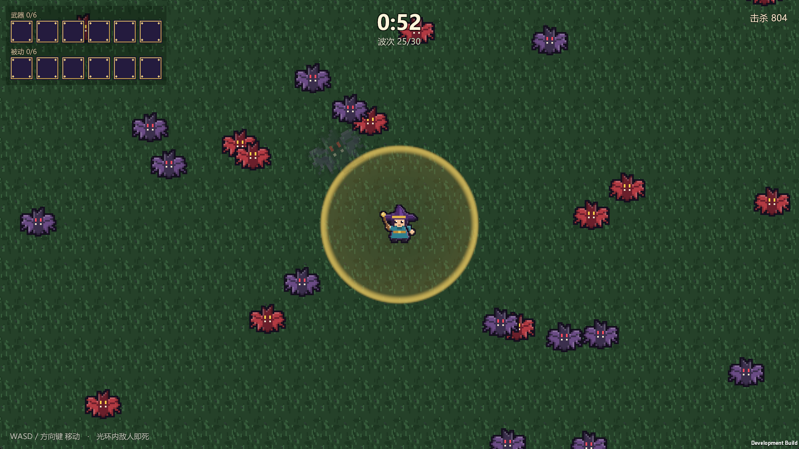

# SurvivorArenaU

用 Unity 2022.3 复刻《吸血鬼幸存者》的个人项目：**只做一关、一个人物，但把这一关涉及的系统做完整**。

> 做什么、不做什么、术语与截图索引，都以范围基准 [Docs/00-profile.md](Docs/00-profile.md) 为准。

**当前阶段：战斗原型。** 已跑通「移动 → 30 波蝙蝠 → 击杀 → 5:00 胜利 → 重开」的测试链路；武器、经验升级、秘法牌等系统尚未接入。



## 快速开始

需要 Unity **2022.3.62f3c1**（Unity 中国版，含 Windows Build Support）与 PowerShell 7。

```powershell
# 占位美术不在版本库内，克隆后先生成（建议在打开 Unity 前执行）
pwsh -File Tools/GenerateSprites.ps1
```

1. 用 Unity Hub 打开仓库根目录。
2. 打开 `Assets/Scenes/MainGame.unity`，点 Play。
3. `WASD` / 方向键移动；单局 5 分钟后按 `R` 重开。

场景由代码生成。重建场景、打 Windows 测试包、调参位置与已知限制，见 [01-测试战斗场景](Docs/01-测试战斗场景.md)。

## 文档

| 文档 | 内容 |
| --- | --- |
| [00-profile](Docs/00-profile.md) | 范围基准：项目定位、保留系统、明确不做的部分、官方简中术语、截图索引 |
| [01-测试战斗场景](Docs/01-测试战斗场景.md) | 当前场景的运行方式、规则、波次 CSV、关键数值、五层架构与目录、验证记录、已知限制 |
| [局内成长与节奏剖析](Docs/吸血鬼幸存者-局内成长与节奏剖析.md) | 原作局内节奏；疯狂森林完整波次表（本场景 CSV 的来源） |
| [局外成长系统拆解](Docs/吸血鬼幸存者-局外成长系统拆解.md) | 原作局外成长资料；本项目不实现，供理解机制用 |
| [秘法牌系统详细解析](Docs/吸血鬼幸存者-秘法牌系统详细解析.md) | 保留的 8 张秘法牌：机制、数值与受影响武器 |

## 说明

- 个人学习项目，非商业用途。《吸血鬼幸存者》版权归 poncle 所有，本仓库不含原作素材。
- 当前美术是 `Tools/GenerateSprites.ps1` 生成的占位图；正式资源覆盖同名 PNG 即可，meta 中的 GUID 由路径决定，场景引用不会断。
- `Assets/Art`、`Docs/images`、`Docs/Generated` 不入库，克隆后文档中的原作截图与预览图链接不可用；运行所需的占位图按上文生成。
